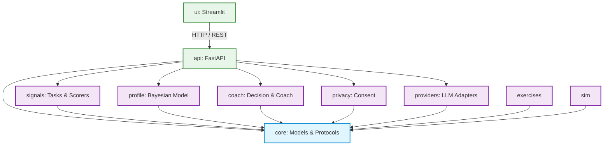
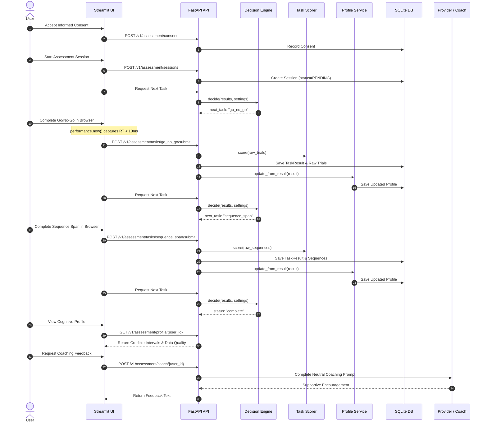

# CogLayer Architecture

This document describes the architectural structure, design principles, dependency rules,
and operational workflows of CogLayer.

---

## 1. Overview

CogLayer is a provider-agnostic cognitive coaching layer positioned between a user and any
Large Language Model (LLM). Its mission is to support learning and cognitive self-reflection
through an adaptive cycle: **Assess → Understand → Coach → Improve**.

CogLayer acts as a cognitive mirror: while traditional alignment uses human feedback to improve
models (RLHF), CogLayer uses interactive micro-tasks and model interactions to help users understand
and strengthen their own cognitive performance.

### Non-Clinical Foundation
CogLayer is strictly **non-clinical**:
- It provides educational coaching and never performs medical or clinical evaluation.
- It adheres strictly to non-clinical vocabulary across all documentation, prompts, and interfaces.
- Cognitive dimensions represent observable performance tendencies on specific tasks (such as response inhibition or sequential visual memory), not fixed human traits.
- The cognitive profile is never transmitted to LLM providers; providers receive only neutral coaching prompts with anonymized guidance notes.

---

## 2. Module Map

CogLayer is structured as a Python monorepo (`coglayer`) with well-defined boundaries:

| Module | Responsibility | Key Components |
|---|---|---|
| `core` | Domain models, protocols, exceptions, and global configuration. No project imports. | `TaskResult`, `CognitiveProfile`, `ScoringAdapter`, `Settings` |
| `signals` | Behavioral signal extraction and micro-task scoring adapters. | `GoNoGoScorer`, `SequenceSpanScorer`, `InMemoryTaskRegistry` |
| `profile` | Uncertainty-aware Bayesian profile estimation and update service. | `BetaProfileModel`, `ProfileService`, `DIMENSION_MAPPING` |
| `coach` | Adaptive assessment sequencing and supportive coaching generation. | `AdaptiveDecisionEngine`, `CognitiveCoach` |
| `privacy` | Informed consent tracking, retention, and data deletion. | `ConsentService`, `ConsentRecord` |
| `providers` | LLM adapters with contract conformance. | `LLMProvider`, `FakeProvider` |
| `exercises` | Exercise generation and verification (extensibility stub). | Reserved for Layer C adaptive practice generation |
| `sim` | Synthetic simulation models and evaluation metrics. | Reserved for synthetic benchmark users |
| `api` | Composition layer: FastAPI REST service and SQLite persistence. | `app.py`, `SQLiteAssessmentRepository`, routers |
| `ui` | Composition layer: Streamlit user interface and task frontends. | `app.py`, interactive HTML/JS timing components |

---

## 3. Dependency Direction

CogLayer strictly enforces dependency flow using `import-linter`. The architecture distinguishes
between the independent **Core**, isolated **Domain Modules**, and the outer **Composition Layer**.



### Architectural Contracts
1. **Contract (a) — Core Independence**: `coglayer.core` imports nothing from any other module in the project. It relies solely on the Python standard library and Pydantic.
2. **Contract (b) — Domain Isolation**: Domain modules (`signals`, `profile`, `coach`, `privacy`, `providers`, `exercises`, `sim`) import only from `core`. They **never import each other**.
3. **Contract (c) — Downward Visibility**: Domain modules never import from the composition layer (`api` or `ui`).
4. **Contract (d) — UI Separation**: `coglayer.ui` communicates with `coglayer.api` exclusively over HTTP via `httpx`. The UI never imports domain modules directly.

---

## 4. Data Flow

The primary assessment flow follows a standardized sequential path:



### Happy Path Steps
1. **Consent**: The user reviews stored data details and local-mode guarantees, granting consent.
2. **Session Creation**: An assessment session is initialized in `PENDING` state.
3. **Task 1 (Go/No-Go)**: Browser JavaScript displays visual stimuli and captures millisecond response times via `performance.now()`. On completion, raw trial data is submitted to the API.
4. **Scoring & Profile Update**: `GoNoGoScorer` computes omission errors, commission errors, mean RT, and completeness (filtering anticipation responses < 100 ms). `ProfileService` updates the Bayesian Beta distribution for `response_inhibition`.
5. **Task 2 (Sequence Span)**: Browser JavaScript presents visual block sequences. On completion or 30-second timeout, results are submitted. `SequenceSpanScorer` scores max span and visual memory metrics. `ProfileService` updates `sequential_visual_memory`.
6. **Completion & Profile Review**: `AdaptiveDecisionEngine` verifies that both tasks meet completeness thresholds (≥ 0.80) and marks the session complete. The UI renders 90% credible intervals and data quality indicators.
7. **Coaching Feedback**: With the session complete, the coach lock unlocks (HTTP 200). `CognitiveCoach` composes a supportive summary referencing metric ranges and appends a mandatory non-clinical disclaimer.

---

## 5. Storage Architecture

Data persistence is managed via SQLite in `src/coglayer/api/db/`:

### Schema Overview
- **`consent`**: Tracks user consent status (`user_id`, `consented_at`, `revoked_at`).
- **`sessions`**: Stores session state (`session_id`, `user_id`, `status`, `created_at`, `completed_tasks`).
- **`trials`**: Stores granular raw trial records for reproducibility (`session_id`, `task_id`, `trial_index`, `stimulus`, `response`, `rt_ms`, `is_valid`, `invalid_reason`).
- **`task_metrics`**: Stores aggregated metrics per task execution (`session_id`, `task_id`, `metrics_json`).
- **`data_quality`**: Tracks validity and completeness indicators (`session_id`, `task_id`, `completeness`, `valid_trials`, `total_trials`).
- **`profiles`**: Stores serialized JSON blobs of `CognitiveProfile` keyed by `user_id`.

### Storage Swappability
All database interactions are defined through abstract protocols in `src/coglayer/core/protocols.py`:
- `AssessmentRepository`
- `ProfileRepository`
- `ConsentRepository`

The current SQLite implementation (`SQLiteAssessmentRepository`, etc.) uses standard parameterized queries and context-managed connections. Swapping SQLite for PostgreSQL, DynamoDB, or Redis requires implementing these protocols without altering any domain or routing code.

---

## 6. Testing Strategy

CogLayer adheres to a rigorous multi-tiered testing strategy enforced by `make check`:

1. **Unit Tests (`tests/unit/`)**:
   - Isolated and fast; make **zero network calls**.
   - Use `FakeProvider` for deterministic LLM responses.
   - Verify exact mathematical values for scorers (`test_gng_scorer.py`, `test_span_scorer.py`).
   - Validate coach lock mechanisms, consent workflows, and decision rules.

2. **Property-Based Tests (`hypothesis`)**:
   - Validate mathematical invariants over 100+ generated inputs:
     - **Property 1**: Beta updates maintain mean in `[0, 1]`.
     - **Property 2**: 90% credible intervals always contain the mean (`lower <= mean <= upper`).
     - **Property 3**: Adding evidence never widens the interval beyond the initial prior.
     - **Property 4**: Forgetting factor ($\lambda = 0.98$) preserves $\alpha, \beta \ge 1.0$.
     - **Property 5 & 6**: Task scoring completeness remains strictly bounded in `[0, 1]`.
     - **Property 7**: Anticipation exclusion (< 100 ms) is invariant to trial order.
     - **Property 8**: `delete_user` completely removes all user records across all tables.

3. **Integration Tests (`tests/integration/`)**:
   - Exercise full API flows end-to-end using FastAPI `TestClient` and isolated SQLite databases.
   - Cover all named acceptance criteria from REQ-011 (`test_full_loop.py`, `test_second_session.py`).

4. **Coverage Targets**:
   - Overall repository target: $\ge 85\%$.
   - Core domain modules (`profile` and `coach`): $\ge 95\%$ (currently 100%).

---

## 7. Adding a New Cognitive Task

The system follows the Open-Closed Principle: adding a new task requires **zero changes** to existing domain logic.

### Step-by-Step Guide
1. **Define the Scorer**:
   Create `src/coglayer/signals/<new_task>.py` implementing `ScoringAdapter`:
   ```python
   class NewTaskScorer(ScoringAdapter):
       def score(self, raw_payload: dict[str, Any]) -> TaskResult:
           # Validate raw trials and compute metrics
           ...
   ```
2. **Define Dimension Mapping**:
   In `src/coglayer/profile/service.py`, add the mapping to `DIMENSION_MAPPING`:
   ```python
   "new_task": [
       DimensionMapping(
           task_id="new_task",
           metric="accuracy",
           weight=1.0,
           dimension="logical_reasoning",
       )
   ]
   ```
3. **Register the Task**:
   In `src/coglayer/signals/registry.py`, register the task descriptor and scorer in `build_default_registry()`:
   ```python
   registry.register(
       TaskDescriptor(
           task_id="new_task",
           version="1.0",
           name="New Logic Task",
           dimension_targets=["logical_reasoning"],
           parameters={},
       ),
       scorer=NewTaskScorer(),
   )
   ```
4. **Add UI Component**:
   Create `src/coglayer/ui/pages/new_task.py` and mount it in `src/coglayer/ui/app.py`.

---

## 8. Running Locally

### 1. Installation
Install all dependencies and git pre-commit hooks:
```bash
make install
```
*(Or manually: `uv sync --all-extras; uv run pre-commit install`)*

### 2. Verify Quality Gate
Run the complete verification suite:
```bash
make check
```

### 3. Start the Services
In terminal 1, start the API server:
```bash
uv run uvicorn coglayer.api.app:app --reload --port 8000
```

In terminal 2, launch the Streamlit frontend:
```bash
uv run streamlit run src/coglayer/ui/app.py
```

### 4. Run the Standalone Simulation Demo
To verify the full API workflow without a browser, execute the automated demo simulation:
```bash
uv run python scripts/demo_simulation.py --api-url http://localhost:8000
```
